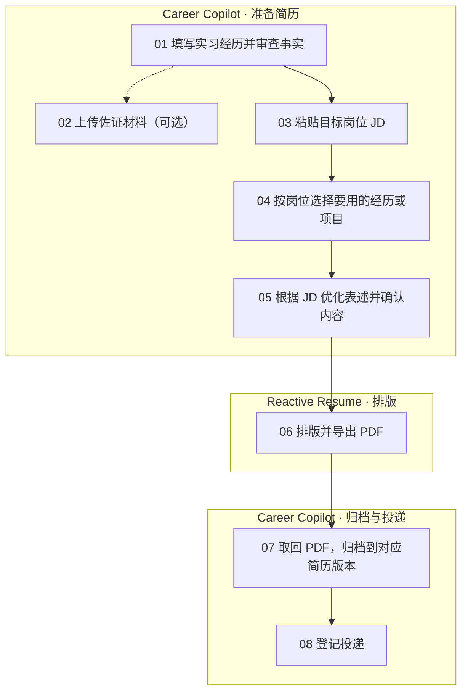

<p align="center">
  
</p>

<h1 align="center">Career Copilot</h1>

<p align="center"><strong>把真实经历整理成可追溯的简历，并记住每次投递用的是哪一版。</strong></p>

<p align="center">Windows 桌面应用 · Tauri / Rust · React / TypeScript · SQLite</p>

[快速开始](#快速开始) · [求职流程](#求职流程) · [管理佐证材料](#管理佐证材料) · [产品设计与交付](#产品设计与交付) · [开源致谢](#开源致谢) · [连接服务](#连接服务)

每准备一个新岗位，你都可以从已经审查的职业事实中重新选材。Career Copilot 保存事实修订、简历内容快照、最终 PDF 和投递记录，让你能回看一份简历写了什么、引用了哪些事实、最终发出去的是哪个文件。

## 求职流程



| 环节 | 可以做什么 |
| --- | --- |
| **01–02 整理经历** | 填写机构、项目和贡献，上传报告、截图或工作记录作为佐证。也可把文件放入资产的材料目录，手动刷新或重启自动导入。事实仍需逐条审查。 |
| **03–04 针对岗位选材** | 粘贴 JD、整理能力要求，从已确认的事实中选择要放进这份简历的经历或项目。 |
| **05 优化表述** | 可让 AI 根据 JD 和所选事实提出改写建议。应用改写后须重新审查事实，再生成并确认简历内容版本。 |
| **06 排版并输出** | 在 Reactive Resume 中打开该版本的排版副本，选择模板并导出 PDF。也可导出 Markdown、HTML 或 JSON Resume 走手工排版流程。 |
| **07–08 归档与投递** | 回到 Career Copilot 取回或上传最终 PDF，绑定到对应内容版本。实际投递后手动登记渠道和状态，已用于投递的文件绑定会冻结。 |

## 管理佐证材料

在桌面版的「职业资产」中，找到要补充材料的实习、工作或项目卡片。

1. **上传文件**。点击「上传佐证材料」，选择报告、截图或工作记录。
2. **从资源管理器导入**。点击「打开材料目录」，把文件或文件夹复制进去。复制完成后，回到应用点击「刷新材料」。桌面版启动时也会扫描未归档资产已有的材料目录，自动导入关机期间新增的文件。
3. **核对原件**。点击材料列表里的文件名即可下载。相同内容按资产去重，修改后的文件会新增一份归档。移出材料目录中的源文件时，已归档的版本仍可回查。

支持 PDF、DOCX、PPTX、XLSX、PNG、JPG、TXT、Markdown，以及 ZIP、7Z、RAR。单份文件最多 15 MB。文件夹会扫描子目录，压缩包按原件归档。

> [!NOTE]
> 材料保存在本机，当前关联到整段职业资产。使用时可对照原件录入和审查事实。从材料自动提取经历、生成表述和逐条绑定证据仍在计划中。

## 产品设计与交付

这个项目起于两个实际需求：为不同岗位反复写简历时，能复用已经核实的经历；投递之后，能查回当时发出的具体版本。我把这两个需求拆成可验收的产品规则：

- **经历可以复用，改写需要复核。** 记录事实及其修订，为岗位选择已确认的事实。AI 提出的改写经过用户确认后进入待审查状态。
- **版本可以回查。** 确认简历时保留文字和事实引用，登记投递时绑定最终 PDF。后续修改形成新版本，旧投递仍可追溯。
- **排版可以独立演进。** 先跑通手工选材、导出和归档，再通过 JSON 交换验证字段映射，随后接入排版 API。用合成数据验证副本复用、无效 PDF 拒绝和重启后的归档记录。

需求、工程约束和交付验证分别记录在[产品规格](PRODUCT_SPEC.md)、[实施计划](IMPLEMENTATION_PLAN.md)和[交付记录](docs/DELIVERY.md)。

## 开源致谢

- **Reactive Resume 团队和贡献者**提供简历编辑器、模板与 PDF 导出。Career Copilot 参考其导入格式，并调用其公开 REST API 创建排版副本、取回 PDF。Career Copilot 负责职业事实审查、岗位选材、本地版本关联和投递归档。[上游项目](https://github.com/reactive-resume/reactive-resume) · [API 文档](https://docs.rxresu.me/guides/using-the-api)
- **GitHub Awesome Copilot 的贡献者**提供了 README 写作参考。本页的导览与快速开始参考了其 `create-readme` 技能。[技能源码](https://github.com/github/awesome-copilot/blob/main/skills/create-readme/SKILL.md)

## 快速开始

**先体验界面。** 安装 Node.js 22.12 或更高版本，在仓库目录运行：

```powershell
npm ci
npm run dev
```

打开 [http://127.0.0.1:5173/](http://127.0.0.1:5173/)，即可用合成数据体验界面和 AI 侧栏。浏览器演示无需 API Key，刷新后会重置演示状态。

**使用个人工作区。** 在 Windows 安装 Rust、C++ Build Tools 和 WebView2，安装 npm 依赖后运行：

```powershell
npm run tauri -- dev
```

桌面版默认进入本地个人工作区，也可从侧栏切换到演示。可在 [Windows 桌面环境说明](docs/DESKTOP_SETUP.md) 中查看工具链和构建步骤。

## 连接服务

两项连接都可选，使用各自的 API Key。手工审查、选材、导出和归档均可在未配置服务时使用。

| 设置项 | 用途 | 首次配置 |
| --- | --- | --- |
| **模型连接** | 分析岗位要求、提问、生成事实改写建议。发送前可查看所选上下文。确认应用后，改写进入待审查状态。 | 在“设置与数据 → 模型连接”填写兼容 Chat Completions 的基础地址、模型 ID 和 Key，保存后测试。[模型配置说明](docs/AI_CONNECTION.md) |
| **Reactive Resume** | 为确认的内容版本创建排版副本。重复打开同一版本会复用副本，完成排版后可取回 PDF 并归档。 | 在“设置与数据 → Reactive Resume”填写站点及该账号的 Key。连接测试检查读取权限，创建副本需要写权限。[排版互通说明](docs/REACTIVE_RESUME.md) |

> [!NOTE]
> SQLite 和归档文件保存在本机工作区，API Key 存在 Windows 凭据管理器。主动调用模型或创建外部排版副本时，所选内容会发送到你配置的服务。可以用 `CAREER_COPILOT_WORKSPACE` 指定本地工作区的绝对路径。

## 开发与验证

| 命令 | 覆盖内容 |
| --- | --- |
| `npm run check` | 文档链接、单元测试、类型检查、前端构建及浏览器流程 |
| `npm run check:rust` | Rust 检查与存储、业务、模型调用合同测试 |
| `npm run tauri -- build --debug --no-bundle` | 构建 Windows 调试版，产物位于 `src-tauri/target/debug/career-copilot.exe` |
| `npm run test:desktop:workspace` | 从职业事实到投递的桌面流程，含重启后的持久化检查 |
| `npm run test:desktop:ai` / `npm run test:desktop:reactive-resume` | 使用本机模拟接口检查模型调用、排版连接和 PDF 归档 |

桌面测试使用合成数据和隔离工作区。真实模型表现及 Reactive Resume 账号内的排版效果，需在各自配置的服务中验证。批量材料解析、访谈和自动选材优化仍在交付计划中。

[产品规格](PRODUCT_SPEC.md) · [技术规格](TECH_SPEC.md) · [交付记录](docs/DELIVERY.md) · [作品集说明](docs/PORTFOLIO.md)
