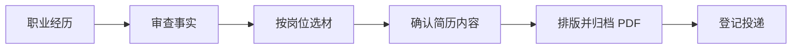

<p align="center">
  
</p>

<h1 align="center">Career Copilot</h1>

<p align="center"><strong>把真实经历整理成可追溯的简历，并记住每次投递用的是哪一版。</strong></p>

<p align="center">Windows 桌面应用 · Tauri / Rust · React / TypeScript · SQLite</p>

[快速开始](#快速开始) · [求职流程](#求职流程) · [连接服务](#连接服务) · [开发与验证](#开发与验证)

每准备一个新岗位，你都可以从已经审查的职业事实中重新选材。Career Copilot 保存事实修订、简历内容快照、最终 PDF 和投递记录，让你能回看一份简历写了什么、引用了哪些事实、最终发出去的是哪个文件。

## 求职流程



| 环节 | 可以做什么 |
| --- | --- |
| **整理经历** | 记录机构、项目和贡献，逐条审查事实。数字和职责等高风险陈述需要额外确认。 |
| **针对岗位选材** | 保存 JD 和能力要求，从已确认的事实中选择本次要用的经历。 |
| **确定简历版本** | 生成内容快照并确认就绪。后来修订事实时，既有快照仍保留原文与引用。 |
| **排版并归档** | 在 Reactive Resume 中打开已确认版本的排版副本，完成后取回 PDF。也可导出 Markdown、HTML 或 JSON Resume，再手动上传最终 PDF。 |
| **记录投递** | 手动登记投递渠道和状态。PDF 通过 SHA-256 核对完整性，已用于投递的文件与版本绑定会冻结。 |

## 快速开始

**先体验界面。** 安装 Node.js 22.12 或更高版本，在仓库目录运行：

```powershell
npm ci
npm run dev
```

打开 [http://127.0.0.1:5173/](http://127.0.0.1:5173/)，即可用合成数据体验界面和 AI 侧栏。浏览器演示无需 API Key，刷新后会重置演示状态。

**使用个人工作区。** 在 Windows 安装 Rust、C++ Build Tools 和 WebView2，安装 npm 依赖后运行：

```powershell
npm run tauri -- dev
```

桌面版默认进入本地个人工作区，也可从侧栏切换到演示。可在 [Windows 桌面环境说明](docs/DESKTOP_SETUP.md) 中查看工具链和构建步骤。

## 连接服务

两项连接都可选，使用各自的 API Key。手工审查、选材、导出和归档均可在未配置服务时使用。

| 设置项 | 用途 | 首次配置 |
| --- | --- | --- |
| **模型连接** | 分析岗位要求、提问、生成事实改写建议。发送前可查看所选上下文。确认应用后，改写进入待审查状态。 | 在“设置与数据 → 模型连接”填写兼容 Chat Completions 的基础地址、模型 ID 和 Key，保存后测试。[模型配置说明](docs/AI_CONNECTION.md) |
| **Reactive Resume** | 为确认的内容版本创建排版副本。重复打开同一版本会复用副本，完成排版后可取回 PDF 并归档。 | 在“设置与数据 → Reactive Resume”填写站点及该账号的 Key。连接测试检查读取权限，创建副本需要写权限。[排版互通说明](docs/REACTIVE_RESUME.md) |

> [!NOTE]
> SQLite 和归档文件保存在本机工作区，API Key 存在 Windows 凭据管理器。主动调用模型或创建外部排版副本时，所选内容会发送到你配置的服务。可以用 `CAREER_COPILOT_WORKSPACE` 指定本地工作区的绝对路径。

## 开发与验证

| 命令 | 覆盖内容 |
| --- | --- |
| `npm run check` | 文档链接、单元测试、类型检查、前端构建及浏览器流程 |
| `npm run check:rust` | Rust 检查与存储、业务、模型调用合同测试 |
| `npm run tauri -- build --debug --no-bundle` | 构建 Windows 调试版，产物位于 `src-tauri/target/debug/career-copilot.exe` |
| `npm run test:desktop:workspace` | 从职业事实到投递的桌面流程，含重启后的持久化检查 |
| `npm run test:desktop:ai` / `npm run test:desktop:reactive-resume` | 使用本机模拟接口检查模型调用、排版连接和 PDF 归档 |

桌面测试使用合成数据和隔离工作区。真实模型表现及 Reactive Resume 账号内的排版效果，需在各自配置的服务中验证。批量材料解析、访谈和自动选材优化仍在交付计划中。

[产品规格](PRODUCT_SPEC.md) · [技术规格](TECH_SPEC.md) · [交付记录](docs/DELIVERY.md) · [作品集说明](docs/PORTFOLIO.md)
