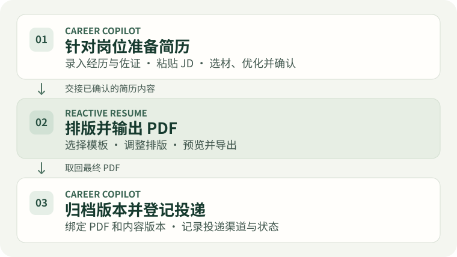
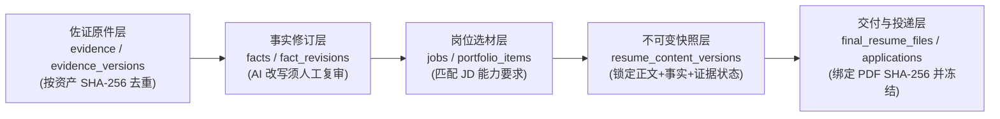
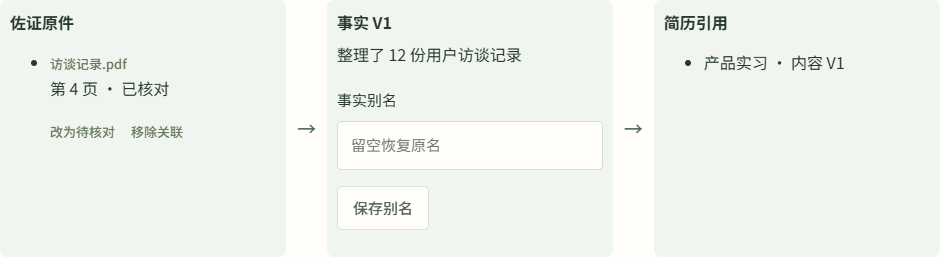

<p align="center">
  
</p>

<h1 align="center">Career Copilot</h1>

<p align="center"><strong>把真实经历整理成可追溯的简历，并记住每次投递用的是哪一版。</strong></p>

<p align="center">
  
  
  
  
</p>

<p align="center">
  <a href="#快速开始">快速开始</a> ·
  <a href="#核心设计原则">核心设计原则</a> ·
  <a href="#求职流程">求职流程</a> ·
  <a href="#数据流向">数据流向</a> ·
  <a href="#事实与证据">事实与证据</a> ·
  <a href="#为什么接入-reactive-resume">开源集成</a> ·
  <a href="#连接服务">连接服务</a> ·
  <a href="#开源致谢">开源致谢</a> ·
  <a href="#开发与验证">开发与验证</a>
</p>

每投递一个新岗位，你都可以从已经核实的职业事实中重新选材，而不是在几十份命名混乱的 Word/PDF 里反复复制粘贴。**Career Copilot** 保存事实修订、证据位置、简历内容快照、最终 PDF（SHA-256 摘要）与投递记录，让你在面试前随时回查：**这份简历写了什么、引用了哪条事实、对应哪份原件、最终发出的是哪个文件。**

---

## 适用人群与使用场景

- **适合谁用**：同时投递多个岗位或方向（如数据分析、商业分析、AI 产品、金融科技）的校招/社招求职者，以及项目材料分散在多份报告、截图和代码库中的候选人。
- **适合用来做什么**：
  - 把实习与项目沉淀为可复用的**职业事实库**，并绑定本地原件佐证；
  - 针对不同 JD 精准选材、借助 AI 提出改写建议（人工复核确认），再通过 Reactive Resume 快速排版出 PDF；
  - 面试前一键倒查某家公司收到的具体 PDF、每条经历引用的事实版本与原件页码。
- **不适合做什么**：只想 3 分钟套模板生成一份通用简历，或希望完全由 AI 自动生成经历而不做事实核对的场景。

---

## 核心设计原则

- **本地优先（Local-First）**：职业经历、SQLite 数据库与佐证归档保存在本机工作区，API Key 存入 Windows 凭据管理器，不强制绑定云端服务。
- **人机协同（Human-in-the-Loop）**：AI 只提出改写建议与上下文分析，应用后进入**待审查修订**，须由用户核对确认后才可进入正式简历。
- **全链路可追溯（End-to-End Traceability）**：将事实管理、岗位选材、证据关联与第三方排版解耦，通过版本引用串联，历史投递冻结保留快照。

---

## 求职流程



| 环节 | 核心操作 | 关键约束 |
| --- | --- | --- |
| **1. 整理经历** | 录入机构、项目与贡献，上传或目录导入报告、截图作为佐证 | 事实须逐条审查确认；原件按资产去重归档 |
| **2. 针对岗位选材** | 粘贴 JD、拆解能力要求，从已确认事实中组合本岗素材 | 仅选用已审查通过的事实修订 |
| **3. 优化表述** | 可选调用 AI 基于 JD 与所选事实生成改写建议 | AI 改写进入待审查状态，人工确认后方可入稿 |
| **4. 排版与输出** | 通过 REST API 在 Reactive Resume 创建排版副本并导出 PDF，或导出 Markdown / HTML / JSON Resume 手工排版 | 内容管理与视觉排版独立演进 |
| **5. 归档与投递** | 取回或上传最终 PDF 绑定到内容版本，投递后登记渠道与状态 | 已用于投递的文件绑定自动冻结，历史版本不丢失 |

---

## 数据流向

**职业经历 → 已确认的事实修订 → 岗位选材组合 → 简历内容快照 → 最终 PDF（SHA-256） → 投递记录**

从业务与数据建模视角看，求职材料管理本质上是一个**多对多、随时间演进的不可变快照（Immutable Snapshot）问题**：同一段实习经历在投递不同岗位时会被改写为不同表述，如果原地覆盖修改，就会破坏历史投递的可追溯性。因此底层通过 **31 张 SQLite 关系表与外键约束**构建了五层解耦数据管道：



从任意一次投递都可以完整倒查 **投递记录 → 最终 PDF → 简历内容快照 → 事实版本 → 佐证原件**，修改新版本不会污染任何历史投递记录。

| 数据阶段 | 输入与处理 | 沉淀产物 |
| --- | --- | --- |
| **建立事实** | 录入经历并附原件，人工核对后确认可用事实 | 职业资产、按资产归档的佐证文件、事实修订与审查状态 |
| **岗位选材** | 粘贴 JD 拆解能力要求，选取已确认事实（AI 改写须复审） | 岗位分析版本、选材组合、所选事实修订引用 |
| **简历内容** | 基于确认组合生成简历内容并锁定就绪状态 | 保留正文、事实引用与证据核对状态的简历内容快照 |
| **排版归档** | 送入 Reactive Resume 或手工排版，取回/上传最终 PDF | 与内容版本绑定的最终 PDF 及其 SHA-256 摘要 |
| **登记投递** | 实际投递后手动记录渠道与进度 | 绑定具体 PDF 的冻结投递记录 |

### 示例｜一条事实如何进入简历



> 截图使用演示数据：《反馈汇总.xlsx》同时关联两条事实，每条事实分别连到产品实习简历 V1 中引用它的条目。操作说明见[事实与证据](#事实与证据)。

---

## 快速开始

### 方式一：浏览器快速体验（无需配置 API Key）

安装 Node.js 22.12+，在仓库根目录运行：

```powershell
npm ci
npm run dev
```

打开 [http://127.0.0.1:5173/](http://127.0.0.1:5173/)，即可使用内置合成数据体验完整界面与 AI 侧栏（刷新后重置演示状态）。

### 方式二：启动 Windows 本地桌面工作区

安装 Rust、C++ Build Tools 和 WebView2（详见 [Windows 桌面环境说明](docs/DESKTOP_SETUP.md)），安装依赖后运行：

```powershell
npm run tauri -- dev
```

桌面版默认进入本地个人工作区（可用环境变量 `CAREER_COPILOT_WORKSPACE` 指定绝对路径），也可在侧栏随时切换到演示模式。

---

## 管理佐证材料

在桌面版「职业资产」中打开对应经历或项目卡片：

1. **上传文件**：点击「上传佐证材料」，选择报告、截图或工作记录。
2. **资源管理器导入**：点击「打开材料目录」复制文件/文件夹进去，返回点击「刷新材料」；桌面版启动时也会自动扫描未归档资产目录并导入新增文件。
3. **去重与原件回查**：点击文件名即可下载原件。相同内容按资产去重，修改后的文件另存新归档；移出原目录后已归档版本仍可回查。

支持 PDF、DOCX、PPTX、XLSX、PNG、JPG、TXT、Markdown 及 ZIP / 7Z / RAR（单份最大 15 MB）。

> [!NOTE]
> 材料保存在本机。从原始材料自动提取经历与批量生成表述仍在后续计划中。

---

## 事实与证据

在「职业资产」中展开「证据关系画布」，可直观查看 **佐证原件 → 事实版本 → 简历引用** 三列关系。点击事实卡片上的「核对与修正」，可下载原件、修正证据位置或重新绑定材料；位置变更后自动恢复为「待核对」。

1. **起别名**：在材料列表填写「材料别名」并点击「保存别名」；事实也可在「事实与证据」中设置显示别名。
2. **建立关联**：为当前事实版本选择同一职业资产下的材料，填写「证据位置」（如页码、工作表名或摘录），点击「保存证据关联」。一条事实支持关联多份材料。
3. **核对原件**：下载原件核对位置后点击「标记已核对」。证据关联的核对状态与事实审查状态独立记录。
4. **回查历史**：简历内容确认后，快照固定保存当时的材料名称、别名、位置与核对状态；在「版本资料库」展开对应版本即可查看「事实与证据快照」。

---

## 为什么接入 Reactive Resume

在求职工作流中，**“管好事实与版本”**和**“把简历排得好看”**其实是两件正交的事：
- Career Copilot 要解决的核心痛点是职业资产沉淀、证据核对、跨岗位选材与投递版本追溯；
- 如果从零重复造轮子开发所见即所得的排版编辑器与 PDF 渲染引擎，不仅研发投入重、容易分散主线精力，也很难在短时间内达到成熟开源社区的模板质量。

因此，本项目选择通过格式适配与公开 REST API 集成成熟的开源项目 **[Reactive Resume](https://github.com/reactive-resume/reactive-resume)**，让两端各司其职。

### 接入后的提升

- **打通“内容确认 → 专业排版 → PDF 归档”闭环**：在 Career Copilot 完成事实核对与选材后，一键创建对应版本的排版副本，直接使用 Reactive Resume 丰富的模板与可视化排版能力，再将最终 PDF 自动取回本地归档并计算 SHA-256 摘要；
- **告别手动复制粘贴与版本错乱**：同一内容版本重复打开会自动复用已有排版副本，避免反复导入导出导致的文字错漏或“忘了发的是哪一版”；
- **保持松耦合与独立演进**：排版层完全可选，未配置 Reactive Resume 时仍可导出 Markdown、HTML 或 JSON Resume 走手工排版流程，互不绑死。

---

## 连接服务

两项外部连接均可选；未配置时，手工审查、选材、导出与归档均可完整使用。

| 设置项 | 用途 | 配置方式 |
| --- | --- | --- |
| **模型连接** | 分析 JD、提问、生成事实改写建议（发送前可预览所选上下文） | 在「设置与数据 → 模型连接」填写兼容 Chat Completions 的地址、模型 ID 与 Key，详见[模型配置说明](docs/AI_CONNECTION.md) |
| **Reactive Resume** | 为已确认的内容版本创建/复用排版副本，并取回最终 PDF 归档 | 在「设置与数据 → Reactive Resume」填写站点与账号 Key，详见[排版互通说明](docs/REACTIVE_RESUME.md) |

---

## 产品设计与交付

项目从“跨岗位复用核实经历”与“投递后可倒查具体版本”两个真实痛点出发，拆解为可验收的工程约束与数据契约（31 张 SQLite 表、8 条不变量、7 份 Prompt 契约），先跑通手工选材与本地归档，再通过 JSON 交换验证字段映射，最后对接 Reactive Resume REST API。

详细规格与交付记录见：[产品规格](PRODUCT_SPEC.md) · [技术规格](TECH_SPEC.md) · [实施计划](IMPLEMENTATION_PLAN.md) · [交付记录](docs/DELIVERY.md) · [作品集说明](docs/PORTFOLIO.md)。

---

## 开源致谢

### Reactive Resume

感谢 **Reactive Resume 的作者、维护者与社区贡献者**。其开源简历编辑器、模板和 PDF 导出能力，让 Career Copilot 的求职流程能够延伸到排版与最终文件交付。[上游项目](https://github.com/reactive-resume/reactive-resume)

Career Copilot 通过格式适配和公开 REST API 对接 Reactive Resume，将已确认的简历内容创建为排版副本，并取回 PDF 归档。简历编辑器、模板与 PDF 渲染能力归功于上游项目。[API 文档](https://docs.rxresu.me/guides/using-the-api)

本项目的工作集中在求职需求拆解、职业资产与事实版本管理、岗位选材、证据关系画布、人工核对，以及本地简历归档与投递记录，并完成两端的流程集成。[集成说明](docs/REACTIVE_RESUME.md)

### 文档参考

- **GitHub Awesome Copilot 的贡献者**提供了 README 写作参考（`create-readme` 技能）。[技能源码](https://github.com/github/awesome-copilot/blob/main/skills/create-readme/SKILL.md)

---

## 开发与验证

| 命令 | 覆盖范围 |
| --- | --- |
| `npm run check` | 文档链接与契约检查、单元测试、TypeScript 类型检查、前端构建及浏览器 E2E |
| `npm run check:rust` | Rust 编译检查与存储、业务、AI 调用契约测试 |
| `npm run tauri -- build --debug --no-bundle` | 构建 Windows 调试版（`src-tauri/target/debug/career-copilot.exe`） |
| `npm run test:desktop:workspace` | 从职业事实到投递的桌面全流程及重启持久化验证 |
| `npm run test:desktop:ai` / `npm run test:desktop:reactive-resume` | 本机模拟接口检查模型调用、排版互通与 PDF 归档 |

> 桌面自动化测试基于合成数据与隔离工作区运行；真实模型质量及外部 Reactive Resume 账号排版效果需在各自服务中实测。批量材料解析、模拟访谈与自动选材优化仍在迭代计划中。
